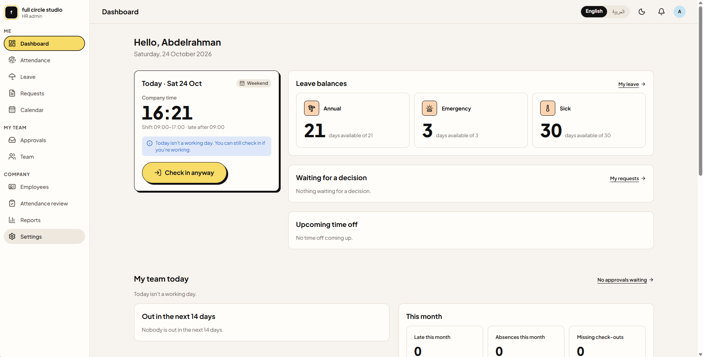
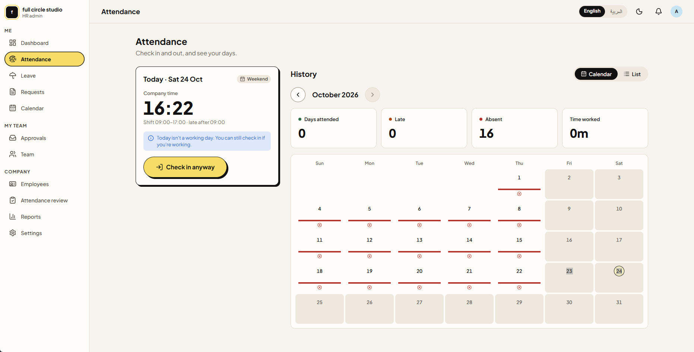
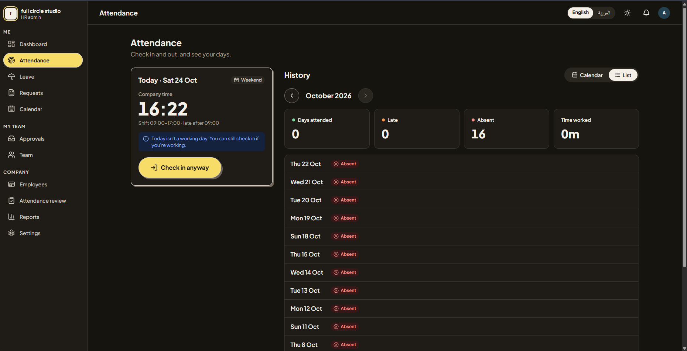
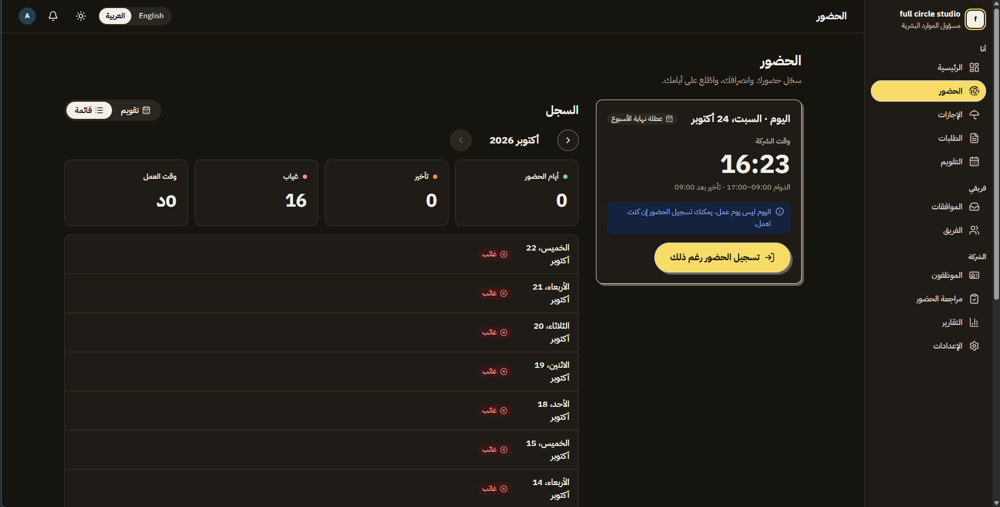
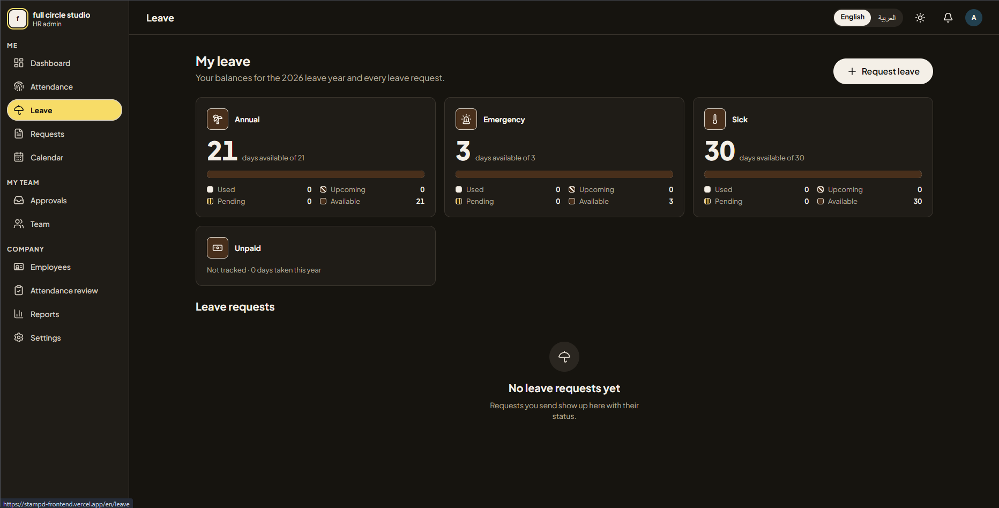
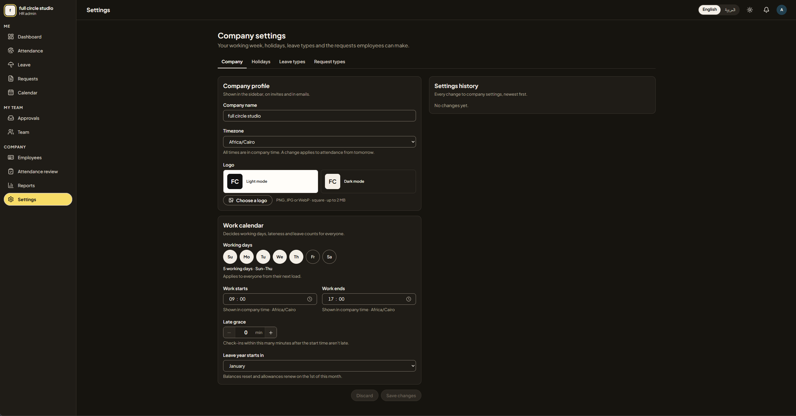
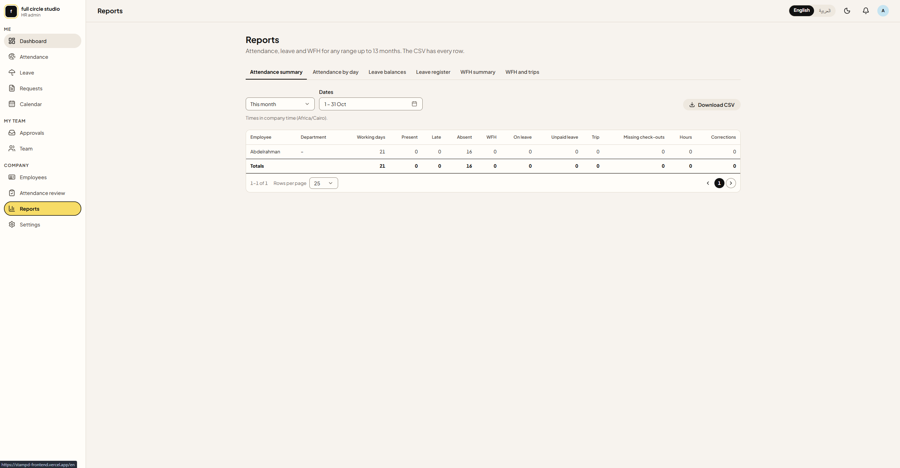
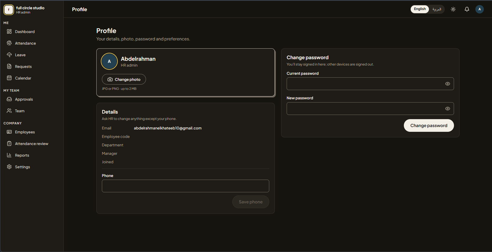

# stampd-frontend

Web frontend for **Stampd**, the Employee Ops Platform: attendance, leave, requests and approvals for GCC teams, in English and Arabic (full RTL).

Every screen reads from and writes to [stampd-backend](https://github.com/abdelrahman-elkhateeb/stampd-backend). There is no mock layer: sign-in, sessions, and all reads and writes are real API calls. The only exception is the dev-only component gallery.



## Screenshots

| | |
|---|---|
|  |  |
| Attendance: check in and the month as a calendar | The same history as a list, in dark mode |
|  |  |
| Arabic, full RTL | Leave balances and requests |
|  |  |
| Company settings: profile, logo and work calendar | Reports with CSV export |
|  | |
| Profile: photo, phone and password | |

## What's in it

| Area | Route | Who |
|---|---|---|
| Sign in, sign up, accept invite, forgot / reset password | `/login`, `/signup`, `/invite`, `/forgot-password`, `/reset-password` | Everyone |
| Dashboard (employee, manager and admin views) | `/` | Every signed-in user |
| Attendance: check in / out, today, monthly history | `/attendance` | Every signed-in user |
| Leave: balances, history, new request with live preview | `/leave`, `/leave/new` | Every signed-in user |
| Requests: list, detail, new request, withdraw / cancel | `/requests` | Every signed-in user |
| Company calendar and availability | `/calendar` | Every signed-in user |
| Profile: details, photo, phone, password, theme | `/me` | Every signed-in user |
| Approvals queue | `/approvals` | Manager, admin |
| My team | `/team` | Manager, admin |
| Employees, departments, balances, CSV import | `/employees` | Admin |
| HR attendance review and corrections | `/attendance-review` | Admin |
| Reports and CSV export | `/reports` | Admin |
| Company settings, holidays, leave types, request types | `/settings` | Admin |

**Not built yet:** in-app notifications (FE-15). They wait on BE-15 in the backend. Until then the bell shows no count, and invite and reset links show up in the backend log rather than in email.

`docs/backend-integration.md` lists which endpoints each screen calls, plus the known simplifications (each marked `ponytail:` in the code). Work is tracked on the Trello board "Employee Ops Platform" (FE-01 … FE-15).

## Getting started

Requires Node ≥ 20.9 and pnpm 11 (`corepack enable`, or `npx pnpm@11.25.0 …`).

**1. Run the backend.** Clone [stampd-backend](https://github.com/abdelrahman-elkhateeb/stampd-backend) next to this repo and follow its README. In short:

```bash
pnpm install && cp .env.example .env
```

```bash
docker compose up -d && pnpm db:setup && pnpm dev
```

That starts MongoDB, seeds a sample company and serves the API on <http://localhost:4000>.

**2. Run the frontend.**

```bash
pnpm install
```

```bash
cp apps/web/.env.example apps/web/.env.local
```

```bash
pnpm dev
```

Open <http://localhost:3000>. You're sent to `/en` or `/ar` based on your browser language, then to login.

**Seeded accounts** (from the backend's seed, one per role): `admin@demo.stampd.app`, `manager@demo.stampd.app`, `employee@demo.stampd.app`, all with password `demo-password`. The manager manages the employee.

Dev-only page (available locally and on previews, 404 in production): `/en/dev/gallery` shows every shared component in each state, with theme, density and language switches. It needs no login and renders with a sample user (`lib/demo-user.ts`).

### Scripts (from the repo root)

| Script | What |
|---|---|
| `pnpm dev` | Dev server |
| `pnpm build` | Production build |
| `pnpm lint` | ESLint; fails on any warning |
| `pnpm typecheck` | Generates route types, then `tsc` |
| `pnpm test` | Unit and component tests (Vitest) |
| `pnpm test:e2e` | Builds, then runs Playwright against `next start`: locale routing, sign-in redirect and login form, RTL, 360px, axe WCAG AA in both themes. It needs no backend, so it doesn't sign in |

Before the first `test:e2e`, install the browser once: `pnpm --filter web exec playwright install chromium`.

### Environment variables

See `apps/web/.env.example`.

| Variable | What |
|---|---|
| `API_BASE_URL` | stampd-backend's URL. Only the Next server calls it |
| `NEXT_PUBLIC_APP_ENV` | `local`, `preview`, `staging` or `production`. `production` hides `/dev/*` |

`NEXT_PUBLIC_*` variables are inlined into the browser bundle, so never put secrets there.

## Stack

Next.js 16 · React 19 · TypeScript · Tailwind CSS v4 · shadcn/ui (`radix-nova`, Radix primitives) · lucide-react · next-themes · next-intl · nuqs · react-hook-form + Zod · Vitest + Testing Library · Playwright · Turborepo · pnpm.

Fonts: Plus Jakarta Sans (Latin), IBM Plex Sans Arabic and IBM Plex Mono, loaded with `next/font`. The reasons for each stack choice are on the FE-01 card in Trello.

## Layout

| Path | What |
|---|---|
| `apps/web` | Next.js app (App Router) |
| `apps/web/app/[locale]` | Every route lives under `/en` or `/ar`. Route files stay thin |
| `apps/web/features/<area>` | Feature code: components, server reads (`<area>-data.ts`) and server actions (`actions.ts`) |
| `apps/web/components` | App shell, status chips, pickers, form fields |
| `apps/web/lib` | App plumbing: API client, session, access rules, formatting, forms, table URL state |
| `apps/web/i18n`, `apps/web/messages` | Locale routing (next-intl) and the English and Arabic message catalogs |
| `apps/web/tests`, `apps/web/e2e` | Vitest tests (mirroring source paths) and Playwright smoke tests |
| `packages/ui` | Shared UI: shadcn/ui (Radix), `src/styles/tokens.css` (the source of truth for tokens) and `src/styles/globals.css` (Tailwind v4 entry) |
| `packages/eslint-config`, `packages/typescript-config` | Shared lint and TS settings |
| `docs/design-system/` | The Stampd design system: principles, decisions, component and pattern specs, and the ticket → component map (`backlog-map.md`). Start with its `README.md` |
| `docs/backend-integration.md` | Screen → endpoint map, data-layer pattern, known simplifications and backend gaps |
| `FRONTEND_API.md` | Full API reference for the frontend: shapes, enums, error codes |

## Sessions and API calls

- **Next.js is the BFF.** The browser never talks to the API. Auth server actions (`features/auth/actions.ts`) keep the tokens in httpOnly cookies (`lib/session.ts`). Server code calls the API with `api()` (`lib/api.ts`), which adds the Bearer token.
- **`proxy.ts`** refreshes an access token that has under 60 s left (the new cookies apply to the same render). It sends signed-out visitors to `/login?returnTo=…`, sends signed-in users away from login and signup, and shows the no-access page for routes the user's role can't open (`lib/access.ts`). It calls `GET /me` only on those restricted routes, because the token carries no role.
- **The user.** `getMe()` on the server (once per request) and `useUser()` in client components (provided by `(app)/layout.tsx`). API shapes are mapped in `lib/user.ts` (`ADMIN` → `admin`, `"SUN"` → `0`).
- **Per feature.** `<area>-data.ts` holds the server reads and maps the API's shape to the app's once. `actions.ts` holds the server actions: each returns a `Problem` or `undefined` and calls `refresh()`. Filters, month, tab and the open item live in the URL (nuqs, `shallow: false`).
- **Errors.** In `api()`, a 401 goes to login. On GETs, a 404 shows the not-found page and a 403 shows the no-access page. Anything else throws `ApiError`, which carries `code`, `fieldErrors` and the request id (shown as the support code).

## Languages and RTL

- Locales: `en` (default) and `ar`. URLs always carry the locale (`/en/…`, `/ar/…`).
- First visit: the `Accept-Language` header decides, with English as the fallback. After that, the `NEXT_LOCALE` cookie remembers the user's choice.
- `<html lang dir>` is set on the server, and Radix components get the direction from `DirectionProvider`.
- Arabic always uses Latin digits and the Gregorian calendar. Format with `getIntlLocale(locale)` from `apps/web/i18n/locale.ts`, never with a bare `"ar"`.
- No hard-coded strings: add each key to both `messages/en.json` and `messages/ar.json`. A unit test fails if the two catalogs differ. Arabic copy needs a native review (`docs/design-system/content.md`).

## Forms and dates

- **Forms.** react-hook-form with a Zod schema and `codeErrorMap`, so errors are codes, translated under the field (`lib/forms.ts`, `components/form-fields.tsx`). API field errors land on the same fields.
- **Dates.** Use `lib/format.ts` (or `useFormat()` in client components). Plain dates (`YYYY-MM-DD`) are formatted in UTC and never shift a day.

## Components

Shared components live in `packages/ui/src/components`, styled to `docs/design-system/components/*.md`. Always import `cn` from `@workspace/ui/lib/utils`: it knows the Stampd theme, so classes like `text-ui` don't silently drop text colours. The app adds translations on top: `components/status.tsx` (status chips), `components/pickers.tsx` (date, range and time fields that use the company calendar), `lib/use-table-url-state.ts` (table state in the URL) and `lib/use-table-labels.ts`.

### Adding shadcn components

**Rule: shadcn first.** Before building anything for a new feature (a component, a sub-part such as menu radio items, or a behaviour such as theming), check whether shadcn already has it ([components](https://ui.shadcn.com/docs/components), [dark mode](https://ui.shadcn.com/docs/dark-mode/next)) and what is already in `packages/ui/src/components`. If shadcn has it, add it with the CLI and restyle it. Write it by hand only when shadcn has nothing for it, and say why in the PR.

From the repo root:

```bash
pnpm dlx shadcn@latest add dialog -c apps/web
```

Components land in `packages/ui/src/components` and pick up the Stampd tokens automatically. Restyle them to the specs in `docs/design-system/components/`.

## Rules that lint enforces

- **Logical properties only** (`ms-`, `pe-`, `start-`, `border-s`, `text-start`). Physical classes such as `ml-2` or `text-left` fail lint, so layouts flip correctly in RTL.
- **No unused code.** TypeScript `noUnusedLocals` / `noUnusedParameters`.

The other rules (tokens only, never colour alone, one hero per screen, …) are in `docs/design-system/README.md`.

## Error pages

| Case | File |
|---|---|
| Unknown URL / `notFound()` | `app/[locale]/not-found.tsx` (localised, 404) |
| Render error | `app/[locale]/error.tsx` (Try again + support code) |
| Root layout crash | `app/global-error.tsx` |

## CI and deploys

GitHub Actions (`.github/workflows/ci.yml`) runs lint, typecheck, unit tests, build and the Playwright smoke tests on every pull request and on `main`.

Preview deploys run on Vercel: connect the repo with **Root Directory** `apps/web`, then set `API_BASE_URL` and `NEXT_PUBLIC_APP_ENV` for Preview and Production. Vercel then posts a preview link on every pull request.

## Known setup notes

- `apps/web/next.config.ts` aliases `next-intl/config` by hand instead of using `next-intl/plugin`. The plugin loads `@swc/core`'s native addon at config time, and that addon refuses to start when the user profile's `AppData` folder grants rights to extra security IDs (seen on Windows with sandboxed tools installed).
